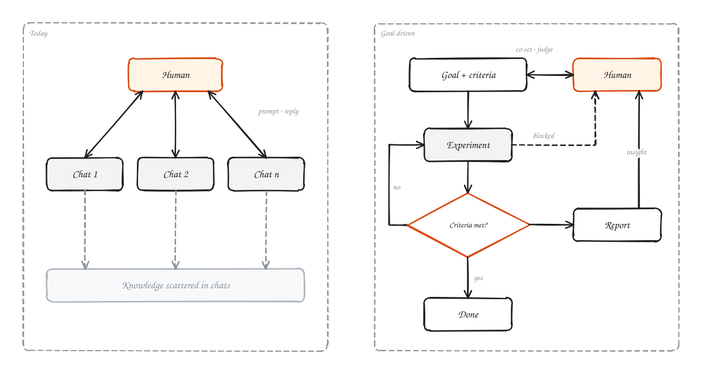
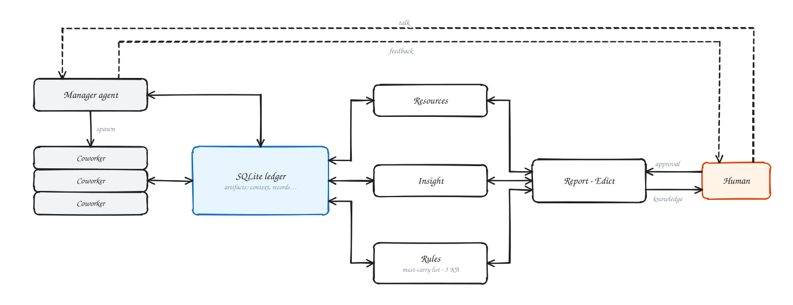
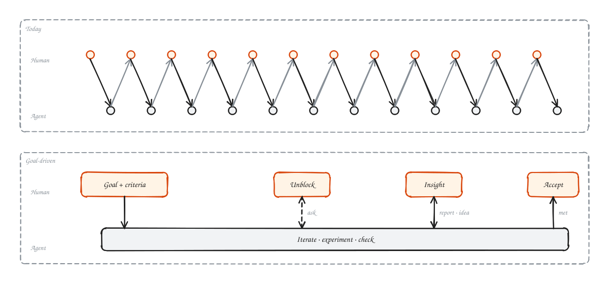
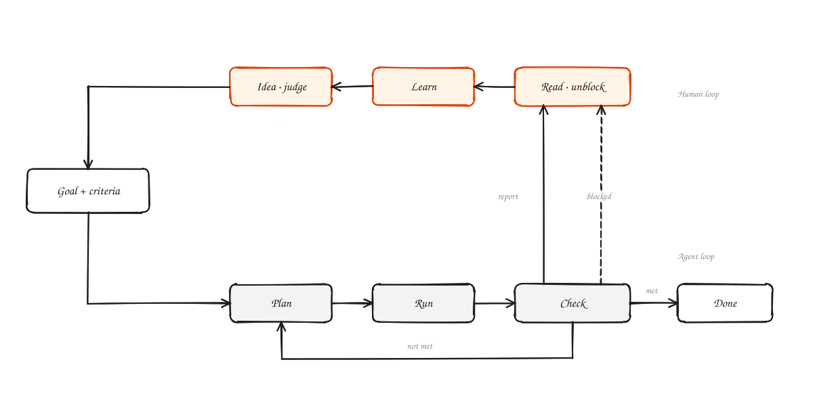
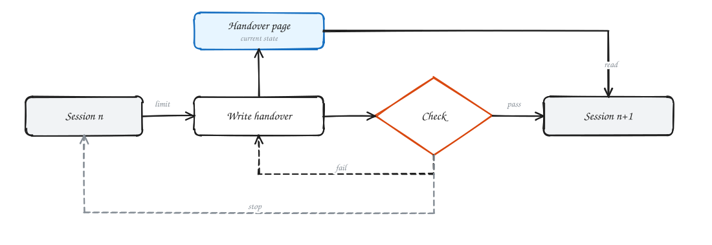
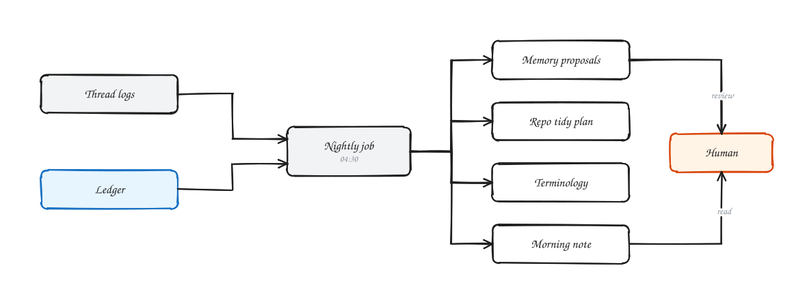

I have been asking myself one question lately: as models keep getting stronger, what should the agents and harnesses around them actually do?

## Three generations in two years

Call the models from the first half of this year (GPT 5.5, Opus 4.6) the last generation, and models like Fable 5.2 the current one.

In 2024 and early 2025, "agentic AI" was a new idea. Models could not reliably search the web or call a tool, and benchmarks like OSWorld and GAIA were measuring exactly that.

By the first half of this year, models used skills and tools fluently. People began to offload real work to them, and AI moved from intern to coworker.

By the second half of the year, many of those skills had been distilled into the base model itself. Hand-configured skills are no longer needed, and some now get in the way.

## Conversation is still the bottleneck

In research, last-generation AI helped with code and with polishing papers, and little else. To trust a result you had to read the code yourself and follow every experiment and its data.

The current generation changes that. Automated research still has real problems, but most of the execution can be offloaded. The human sets direction and decides when to pivot; code review is no longer needed.

Anthropic shows what this looks like at scale. Its monorepo went from about 2,500 merged changes a day in May 2026 to more than 30,000 a day in September, driven by how much of its software Claude now writes, and git itself became the bottleneck, so it was replaced with an in-house system, Scion.[^scion] People there still sign off on changes, but they check the intent of a change rather than reading every line; adversarial review and automated testing carry the rest. Nobody reads 30,000 diffs a day.

Conversation, however, is still at the center. You talk to the model to change course, you read its summaries, and then you carry the conversation over by hand to whichever agent runs the experiments, or you rely on a third-party framework such as [SuperARIS](https://github.com/wanshuiyin/SuperARIS) to wire them together (and many third-party integration tools are still not as good as the vendors' own Claude Code and Codex).

Will the next generation still need to be pushed forward one chat turn at a time? If a person can hand over 90% of the work toward any goal, what is the remaining 10%?

## What the human keeps

My answer: three things.

1. **Resources**: money, compute, accounts, data.
2. **Rules**: permissions and the lines the agent may not cross.
3. **Insight**: knowing what the work has found.

The first two are familiar. The third matters most. Even if the work is fully offloaded, a person who no longer follows what the agent is learning will slowly lose the ability to judge whether its conclusions are right. Something outside the model has to keep the person's insight in step with the agent's. None of the three can be trained into a base model, because they belong to the person and the project.

That is the idea behind **R²I: a next-gen harness built on Resources, Rules and Insight.**

### Why the square

The name has a second reading. In statistics, R² (the coefficient of determination) is the share of the variation that a model explains. Read the person as the model and the project as the data: their R² is how much of what happened in the project they can explain. The more the agents do, the faster that number falls unless something holds it up. The goal of the harness is to keep the person's R² close to 1, so that insight never drops out.

## Five shifts

R²I rests on five shifts in how the harness is built.

### 1. From conversations to a workspace

Today's loop is: a person gives a task, an agent does it, the person replies. One project contains countless small tasks, and each one becomes another long conversation.

The loop I want is different. The person and the agent agree on a goal and on how success will be judged. The agent iterates against that standard on its own, and comes back only when it needs a resource or a permission. In parallel, the agent writes up what each experiment found. The person reads those reports, learns from them, judges the results and proposes new ideas. By the end, the person has the same insight into the project as the agent.

### 2. From sessions to artifacts

Once the base model is strong enough, the chatter between agents is pure noise and information loss. Run five or six projects at once through CLIs, chat windows and context-window compression, and large parts of the context simply go missing. Every session has its own context window, compaction, handoff and memory. As the projects run, all of this keeps forking and duplicating. Left unmanaged, Claude Code and Codex can fill a computer's disk within days and leave folders holding hundreds of millions of randomly named files. With context windows in the millions of tokens, every call re-reads the cache and an extremely long memory context, and compaction inevitably brings serious information loss and makes the agent dumber.

Anthropic's recent post on agent memory draws the same line.[^memory] It treats compaction as a separate mechanism, not memory. Memory is what an agent deliberately writes down for future sessions: notes, linked wiki pages, and a small set of facts injected into every session. Even that injected layer has to stay small, since it costs tokens on every call and spreads any error it contains.

So the real problem is how to let an agent, reading only the context its task needs, recover enough "sanity": a sound understanding of the current project and task.

The session is not the source of truth for knowledge; artifacts and persistent state are. Experimental results, rules, acceptance criteria and decisions already made each have exactly one authoritative record. However many times the executing agent is replaced, every new one resumes from the same state system, not from the previous agent's conversational memory.

### 3. From a super-agent to coordination through artifacts

No amount of compute or context makes it practical for one agent to read everything, understand every detail and relay it all. Agents should coordinate by reading and writing shared artifacts, not by summarizing for each other.

### 4. Memory has to be maintained, not hoarded

A long-running research system that runs ten thousand experiments produces ten thousand handoffs and many more notes. At some point maintaining that memory costs more than doing the work. The same Anthropic post makes this point: memory needs upkeep, and an unpruned memory can cost an agent more than it saves.

Memory, rules, results and the workspace itself need regular clean-up, and that clean-up is a job for agents too. In R²I it runs every night.

### 5. Constrain, don't coach

Weaker models needed a lot of help from the harness: skills, prompts, personas, step-by-step procedures. Stronger models need less of it, and much of it becomes noise that holds them back.

A next-generation harness should provide **tools, rules, resources and persistent state**, not ever-longer instructions.

## What comes next

R²I today is built for the current generation. Four changes I expect as base models improve:

**Dreaming that brainstorms, not just tidies.** Tonight's "dream" pass only proposes memory edits. A stronger nightly agent should do two more things. First, garbage collection: archive and fold away experiment branches that failed and taught nothing. Second, cross-pollination: compare what mainline A and mainline B found, write new hypotheses into the ledger, and put a ready decision on the morning edict, such as "Based on last night's 50 runs, drop plan 2 and test hypothesis X instead."

**An incubation mode.** Quiet execution works once the goal is clear, but getting to a clear goal is still a conversation. In incubation mode the human and the manager agent talk in dense, many-turn exchanges, similar to [ARIS](https://github.com/wanshuiyin/Auto-claude-code-research-in-sleep). Once they agree, one command converges the conversation into ledger records (goals, acceptance criteria, structure), and the project switches to quiet, edict-driven execution.

**More base models, beyond one CLI.** R²I currently runs on Claude Code. Its rules already compile to `CLAUDE.md`, `AGENTS.md` and `GEMINI.md`. The next step is threads and workers on other base models and agent runtimes, all reading and writing the same ledger.

**Fewer edicts over time.** As models get better, the list of things only a human must decide should shrink: fewer approval pages, shorter reports. The ledger still keeps everything for anyone who wants to audit it.

[^scion]: [Redesigning source control at Anthropic](https://www.anthropic.com/engineering/redesigning-source-control), Anthropic Engineering, Oct 13, 2026. “as of September, we merged over 30,000 per day.” · “[…] examine the intent of the change as opposed to reading every line of code.”

[^memory]: [The components of agent memory](https://www.anthropic.com/research/components-of-agent-memory), Lance Martin, Anthropic, Nov 6, 2026. “[…] knowledge that Claude gains from experience […] saved as context it can read later.” · “Memory can also drift and become irrelevant as the environment changes.”
