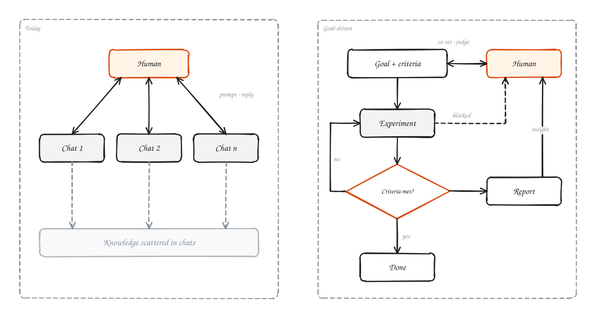
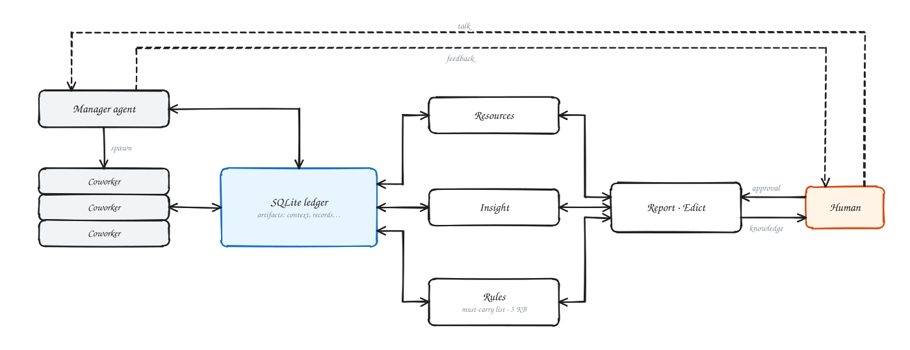
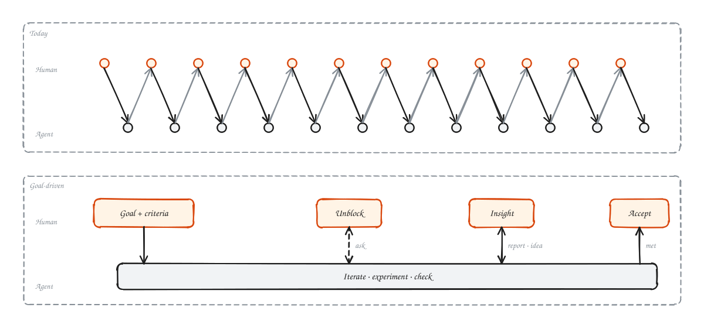
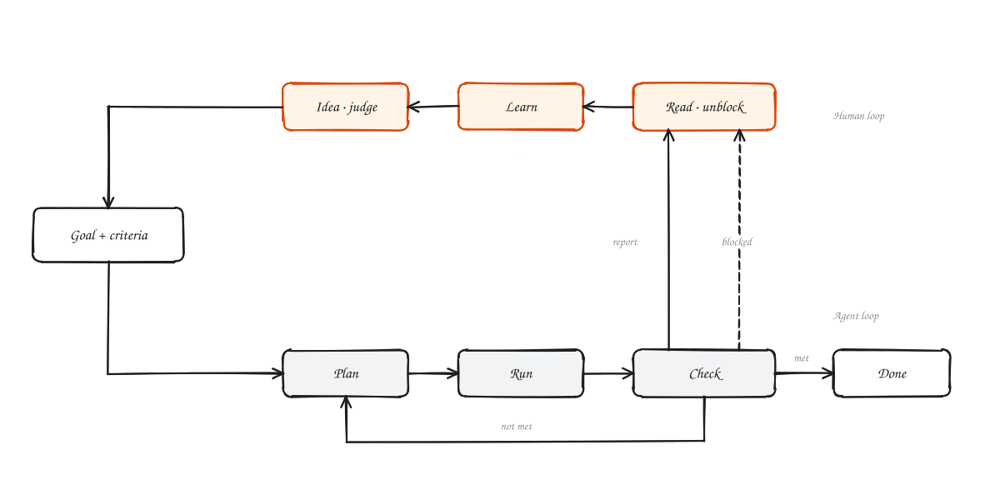
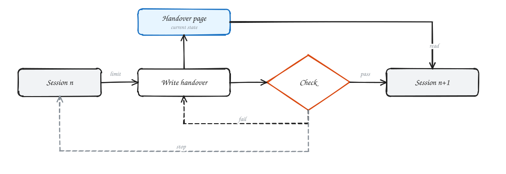
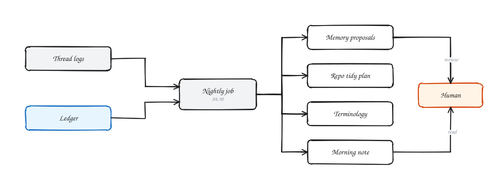

我最近一直在思考，面对 Next-Gen AI，我们究竟该怎么设计对应的 Agent 和 Harness。

## AI 演进的脉络

我把今年上半年的诸如 GPT 5.5、Opus 4.6 等等称为上一代的 AI，Fable 5.2 等等称作这一代，稍微回顾一下 AI 演进的脉络：在 2024 到 2025 年初，Agentic AI 还是个很新的概念，那时候的模型连基本的网页搜索、调用 tools 还做不到，那个时候还有诸如 OSWorld、GAIA 等 benchmark。

到了今年上半年，AI 已经能够熟练用各种 Skills 和 Tools，人类也开始把一大部分工作 offload 给 AI，AI 已经从“intern”转成了“coworker”；而到了今年下半年，很多 Skills 已经被直接 distill 进 base model 里了，根本不需要人再去手动配置各种 Skills，甚至 skills 已经开始拖累现在的 base model。

## 对话依旧是瓶颈

这就引来了一个现实问题，人该如何与 next-gen AI 一起 cowork？拿 research 来说，在 past-gen AI 的时候，绝大部分工作还得人自己干，AI 基本只能辅助一下写代码和润色 paper，人基本要亲自盯着代码、或者完整跟进每一个实验的过程和数据，才能拿到一个靠谱的结果。到了今年这一代，虽然 Auto Research 有很多问题，但大量具体执行的工作已经可以 offload，人只需要把控大方向、做 pivot 就够了，不用再 code review。

Anthropic 自己的 monorepo 就是一个例子：每天合并的代码变更从 2026 年 5 月的约 2,500 个涨到 9 月的 30,000 多个，git 本身成了瓶颈，于是换成了自研的 Scion；他们的工程师看的是变更的意图，不再逐行读代码。[^scion]

但是，在今年这一代，“对话”依旧不可或缺，人还是需要和 AI 持续对话来 pivot 或者查看 AI 的总结，再手动把聊天转交给跑实验的 Agent，或者靠 [SuperARIS](https://github.com/wanshuiyin/SuperARIS) 这类第三方框架去做集成（且不论现在很多第三方集成工具的质量还不如直接用基模厂商的 Claude Code、Codex）。

那么，到了再下一代 AI，它还需要人类通过高频的多轮对话去一步步推着走吗？面对任何目标，人类是不是可以把 90% 以上的工作都彻底交给 AI？那么人到底应该在下一代 workflow/harness 里扮演什么角色？

## 当 Agent 足够聪明时，Harness 还需要负责什么？

我的答案是人只需要掌管三件事：

1. **Resources**：钱、算力、账号、数据。
2. **Rules**：权限，以及 agent 不能越过的线。
3. **Insight**：知道工作发现了什么。

为什么？前两项不用过多说明，第三项我认为是最重要的。随着 AI 的能力越来越强，即便工作可以 offload 给 agent，但假如人类和 AI 的知识不能同步，不能和 AI 在推进的同时一起成长，人类在长久失去上下文认知的节奏下会慢慢失去 judge AI 判断的能力。因此必然需要有外部的 harness 来负责帮助人类理解 AI 到底在做什么。这三点无法被内化进任何 base model。

基于以上三点，我提出 R²I：Next-Gen Harness based on Resources, Rules, Insight。

### 为什么是平方

这个名字还有第二层意思。统计里的 R²（决定系数）衡量一个模型能解释数据中多少比例的变化。把人看作模型、把项目看作数据，人的 R² 就是他能解释项目里发生的事情的程度。agent 干的活越多，这个数掉得越快，除非有东西把它托住。Harness 的目标，就是让人对项目的 R² 保持接近 1：Insight 不掉线。

## 五个转变

### 1. 从 Conversation-Centric 转向 Workspace-Centric

现在的 research flow 是：人类提出任务 → Agent 执行 → 人类继续对话，在一个大任务下有无数小任务，每一个都需要持久对话。

未来的结构应该是：人类和 AI 共同设定一个目标和验收标准 → agent 按照验收标准持续自我迭代和实验 → 遇到资源问题、权限问题找人类解决 → 继续直到标准达标。与此同时，人类持续接收 AI 根据实验写的报告和 insight → 学习到新的知识和 insight → 提出新的想法、judge 实验结果 → 同样获得了项目的一切知识。

### 2. 从 Session/Agent-Centric 转向 Artifact-Centric，从 compaction 转向 handoff + uniform artifact

当 base model 足够强，agent 之间的废话全是 noise 和信息丢失。在同时推进 5 到 6 个项目时，依赖 CLI 或聊天窗口和 context window 的 compression 会导致严重的上下文遗漏。每个 Session 都有自己的 Context Window、Compaction、Handoff 和 Memory。随着项目运行，这些信息会不断分叉和重复，如果不加管制，Claude Code 和 Codex 能在几天内把电脑磁盘占满，文件夹充满上亿随机命名的文件；context window 上百万时，每次调用都会重新读取一遍缓存和极长的记忆上下文，compaction 又不可避免地带来严重的信息损失和降智。

Anthropic 最近讲 agent memory 的文章也划了同样的界线：compaction 不算 memory；memory 是 agent 为以后的 session 有意写下的东西，而且需要维护，不然会随环境变化而过时。[^memory]

因此，真正需要解决的是如何让 Agent 在只读取任务必要上下文的前提下，恢复足够完整的“sanity”，即对当前项目/任务的理解。

Session 不是知识的正本，Artifact 和持久化状态才是。实验结果、规则、验收标准、已作出的决定只保存一份权威记录。无论替换多少次执行 Agent，它们都从同一个状态系统恢复工作，而不是依靠前一个 Agent 的对话记忆。

### 3. 从 “Super-agent” 转向 “Agent-to-Artifact Coordination”

即便拥有再多算力和上下文窗口，也很难存在一个阅读所有工作、理解所有细节、转述所有内容的 super-agent。

### 4. Memory 需要主动维护，而不是无限积累

如果一个长期运行的研究系统做了一万个实验，生成一万个 Handoff，以及更多中间文档，最后维护这些 Memory 的成本可能超过执行成本。

Memory、rules、results 和 workspace 需要定期由 agent 进行整理。

### 5. 下一代 Harness 应该更多地控制 AI，而不是指导 AI

对能力较弱的模型，Harness 要提供大量 skills、prompt、character description 和执行步骤等等。但随着模型能力的增强，大多数都会变成冗余的 context，甚至干扰模型发挥能力。

Tools + Rules + Resources + Persistent State，而不是 skills + prompt。

## 下一步设想

**第一，做梦从整理升级为自我 brainstorm。** 到了下一代基模，“做梦 Agent”在夜间不仅应该做垃圾回收（Garbage Collection，比如自动将 experiments 表里失败且无价值的分支归档折叠），还应该做跨主线的知识交叉（Cross-Pollination）：对比 A 主线和 B 主线的实验结果，主动在 hypotheses 表里生成新的假设，并在早上 7 点的奏折里直接给出一个“基于昨晚 50 组实验，建议废弃原方案二、改测新假设 X”的拍板选项。

**第二，孵化模式。** 在这个模式下，人类与主 Agent 进行高密度的多轮对话（类似 [ARIS](https://github.com/wanshuiyin/Auto-claude-code-research-in-sleep)），一旦达成共识，一键调用脚本将对话收敛转化为台账中的 goals、criteria 和 structures 表记录，随后无缝切入“批奏折”的静默执行模式。

**第三，支持更多 base model，脱离 Claude CLI。** 规则已经能生成 CLAUDE.md、AGENTS.md 和 GEMINI.md，下一步让线程和 worker 跑在别的基础模型上，共用同一份台账。

**第四，奏折越来越少。** 随着 AI 能力越来越强，需要人看的报告和 Edict 会逐渐减少。

[^scion]: [Redesigning source control at Anthropic](https://www.anthropic.com/engineering/redesigning-source-control)，Anthropic Engineering，2026-10-13。原文：“as of September, we merged over 30,000 per day.” · “[…] examine the intent of the change as opposed to reading every line of code.”

[^memory]: [The components of agent memory](https://www.anthropic.com/research/components-of-agent-memory)，Lance Martin，Anthropic，2026-11-06。原文：“[…] knowledge that Claude gains from experience […] saved as context it can read later.” · “Memory can also drift and become irrelevant as the environment changes.”
